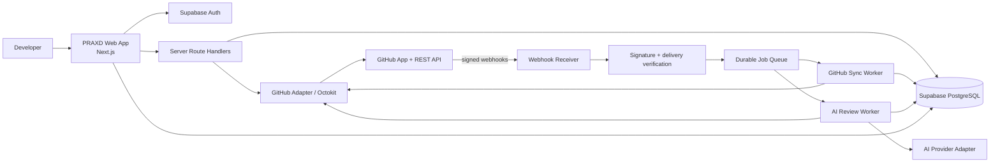
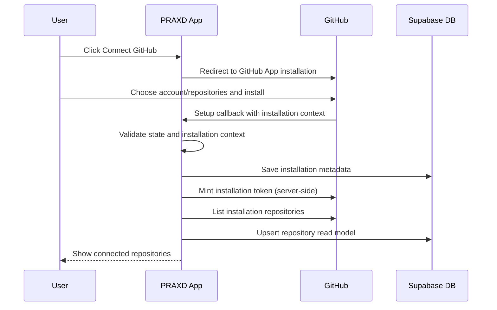
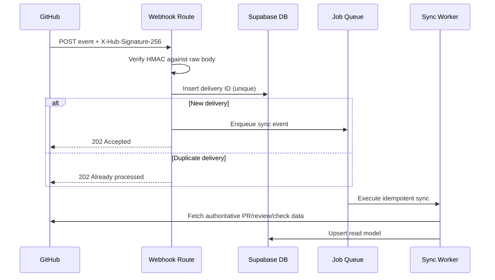
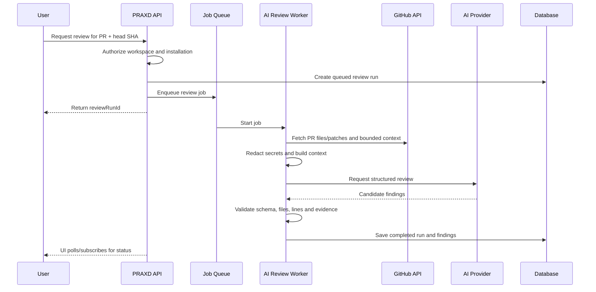

# System Architecture — PRAXD

## 1. Architecture goals

- Securely access GitHub installations and selected repositories.
- Keep the UI responsive while GitHub synchronization and AI review run asynchronously.
- Maintain a tenant-aware local read model for fast PR browsing.
- Make GitHub and AI providers replaceable through adapters.
- Validate every external boundary: user input, webhooks, GitHub responses and model output.

## 2. Recommended stack

| Layer | Choice | Responsibility |
|---|---|---|
| Web | Next.js App Router + TypeScript | UI, server rendering, authenticated route handlers |
| UI | Tailwind CSS + shadcn/ui + Lucide | Components, primitives, icon system |
| Diff | Dedicated React diff viewer (evaluate `@git-diff-view/react` or equivalent) | Split/unified patch rendering |
| Auth | Supabase Auth + `@supabase/ssr` | User sessions and server-side auth |
| Database | Supabase PostgreSQL | Workspaces, synchronized GitHub read model, review history |
| GitHub | GitHub App + Octokit | Installation auth, REST API and webhooks |
| AI | OpenAI API behind provider adapter | Summary and structured code-review findings |
| Jobs | Inngest or equivalent durable queue | PR sync, AI review, retries and scheduled reconciliation |
| Deployment | Vercel | Next.js hosting; background worker deployment must support durable execution |
| Observability | Structured logs + error monitor | Trace failures without logging secrets or source code |

Select exact dependency versions when creating the app and commit the lockfile. Confirm runtime compatibility between Next.js hosting, Supabase and the chosen job runner.

## 3. High-level architecture

## 4. Application layers

### Presentation layer

- Renders PR inbox, Summary, Code, comments, checks, settings and AI review.
- Uses server components for initial secure reads where appropriate.
- Uses client components only for interactive controls, tabs, diff navigation and live states.
- Never calls GitHub directly from the browser.

### Domain/application layer

Suggested domain modules:

- `repositories`: repository list and installation scope.
- `pull-requests`: PR list, summary, files, commits and state.
- `reviews`: GitHub reviews/comments and AI review history.
- `checks`: check runs and commit statuses.
- `integrations/github`: OAuth/install callbacks, app auth, Octokit client and webhook parser.
- `ai-review`: context builder, prompt templates, model adapter, output validator and finding normalizer.
- `workspaces`: tenant membership and access control.

### Infrastructure layer

- Supabase server/client utilities.
- GitHub REST adapter.
- Queue/event adapter.
- AI provider adapter.
- Encryption utilities.
- Logging, tracing and error reporting.

## 5. GitHub integration model

Use a GitHub App installed on a personal account or organization. Store installation metadata, not long-lived plaintext credentials. Generate installation access tokens server-side when needed; keep them ephemeral/in-memory and refresh as required. Keep the GitHub App private key in the server's secret manager/environment, never in the database or client.

The initial app permissions should be minimal:

- Metadata: read (required baseline).
- Contents: read (for bounded related source context if required).
- Pull requests: read (PRs, changed files, reviews and review comments).
- Checks: read (check runs).
- Commit statuses: read (legacy commit status contexts if displayed).

Only add `Pull requests: write` in a later phase if users explicitly enable publishing AI review comments. Do not request Contents write, Actions write, Administration or Merge write for MVP.

Use REST API through an adapter. Where a required UI detail (e.g. review thread resolution state) is not exposed by the chosen REST endpoint, either use the appropriate supported GraphQL API or display the limitation clearly. Do not infer missing data.

## 6. Primary data flows

### 6.1 Initial connection

### 6.2 Webhook synchronization

### 6.3 Manual AI review

## 7. Synchronization strategy

- Webhooks are the fast path; periodic reconciliation is the recovery path.
- Store each GitHub `X-GitHub-Delivery` ID with uniqueness to make retries idempotent.
- Acknowledge valid webhooks quickly after durable acceptance; do not wait for AI or broad API fetches.
- Queue jobs with retry/backoff for 5xx, timeouts and rate limits. Do not retry permanent 4xx permission failures blindly.
- Respect GitHub rate-limit headers and `Retry-After`/reset information.
- Use conditional requests/ETags where supported and cache short-lived read responses.
- Upsert records using GitHub IDs plus repository/PR identifiers.
- Track last synced timestamp, sync cursor/page and last error.
- Reconcile open PRs periodically; synchronize closed/merged events from webhooks.

## 8. Data freshness

The UI must show the last synchronized time where relevant. When a webhook is delayed or a manual refresh is requested, show stale/loading states instead of implying that cached data is live. AI results are tied to a specific PR `head.sha`; any later head SHA invalidates the review's currentness.

## 9. API boundaries

- Browser → PRAXD server only.
- PRAXD server → GitHub using installation credentials.
- GitHub → webhook receiver using signed requests.
- PRAXD worker → AI provider using server-side provider key.
- PRAXD server/worker → Supabase using server-side database access with explicit user/workspace authorization.

## 10. Scaling notes

- Paginate repository, PR, commit, check and file lists.
- Load patches lazily per selected file; don't fetch every patch for every PR at first render.
- Use background jobs for initial repository sync and AI analysis.
- Batch AI review by file/context budget and merge findings after validation.
- Keep large patch/code payloads out of routine logs.
- Add storage retention limits for cached patch text and AI prompt snapshots.
- If deployment runtime does not support durable long-running work, move workers to a dedicated queue/worker runtime instead of forcing long jobs into request handlers.
