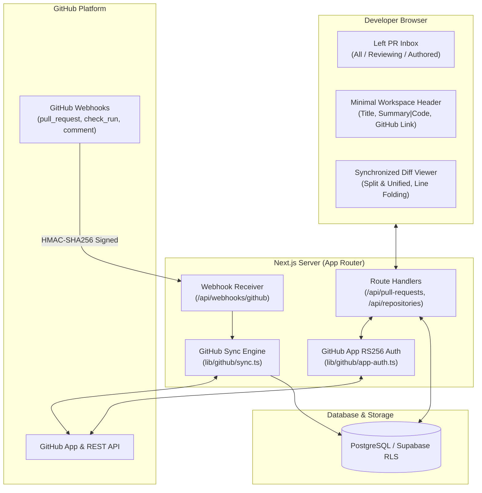

# System Architecture — PRAXD Personal PR Workspace

**Product:** PRAXD  
**Edition:** Personal PR Management Workspace (Option B — Pure Git & PR Focus)  
**Status:** Core Architectural Specification

---

## 1. Architectural Goals

- **Zero AI Overhead:** Eliminate external AI provider dependencies, token costs, prompt latency, and chat drawers.
- **Fast, Focused PR Triage:** Deliver instant inbox filtering, repository discovery, and PR navigation.
- **High-Performance Diff Rendering:** Side-by-side split & unified diffs with synchronized horizontal scroll across Base and Head revisions.
- **Authoritative GitHub Synchronization:** GitHub remains the sole authoritative source of truth; PRAXD maintains a fast, local synchronized read model.
- **Strict Boundary Security:** Verify all webhook HMAC-SHA256 signatures, sanitize metadata, and keep GitHub App private keys strictly server-side.

---

## 2. Technical Stack

| Layer | Technology | Role |
|---|---|---|
| **Web Framework** | Next.js (App Router) + TypeScript | React Server Components & client interaction layers |
| **UI & Styling** | Tailwind CSS + Lucide Icons | Dark-themed design tokens (`#111111`, `#161616`) |
| **Diff Engine** | Custom High-Performance Diff Viewer | Side-by-side split & unified diffs, synchronized scroll lockstep |
| **Auth & Database** | Supabase (PostgreSQL with RLS) | Authenticated personal sessions, local cached PR read model |
| **VCS Integration** | GitHub App + REST Client + Webhooks | RS256 App JWT auth, short-lived tokens, HMAC webhook verification |
| **Deployment** | Vercel / Node.js | Edge-ready serverless and server-rendered execution |

---

## 3. High-Level Architecture Diagram

---

## 4. Application Layers

### Presentation Layer
- **Left PR Inbox (`components/pull-request-sidebar.tsx`):**
  - Instant client-side search and filtering (`All`, `Reviewing`, `Authored`).
  - Resizable sidebar with magnetic snap points (340px, 420px, 540px) and collapse shortcut (`Ctrl+B`).
- **Clean Workspace Header (`components/workspace-header.tsx`):**
  - Displays PR identity, branch comparison, centered `Summary | Code` toggle, external GitHub link, and safe merge button.
  - Zero clutter: No enterprise team buttons, no presence avatars, no chat drawer button.
- **Summary View (`components/summary-view.tsx`):**
  - PR metadata, description markdown, CI/CD check runs list (`CheckRunList`), and activity timeline (`ActivityTimeline`).
- **Code View & Diff Viewer (`components/code-view.tsx`, `components/diff-viewer.tsx`):**
  - Side-by-side split and unified diff switching.
  - Synchronized horizontal scroll lockstep across Base and Head revisions.
  - Sticky multi-file selector dropdown with additions/deletions.

### Server & Domain Layer
- **`lib/github/sync.ts`:** Natural idempotency keys for repositories `(installation_id, github_repo_id)` and PRs `(repository_id, number)`.
- **`lib/github/webhook-verify.ts`:** Constant-time buffer comparison of `X-Hub-Signature-256`.
- **`lib/github/webhook-handlers.ts`:** Event handling for `pull_request`, `check_run`, `issue_comment`, `pull_request_review_comment`.
- **`lib/github/app-auth.ts`:** Ephemeral installation access token caching with in-memory expiration guards.

---

## 5. Security & Isolation

- **Server-Only Credentials:** `GITHUB_APP_PRIVATE_KEY_BASE64` and `GITHUB_WEBHOOK_SECRET` stay exclusively on the server.
- **No Prompt Injections or Model Leaks:** Without external AI models or chat engines, there is zero risk of prompt injection, secret exfiltration via LLMs, or token overages.
- **Constant-Time Verification:** Webhook signatures are verified using `crypto.timingSafeEqual`.
- **Read-Only Baseline:** PR review operations are read-only; destructive merge actions are safely guarded with links to GitHub.
