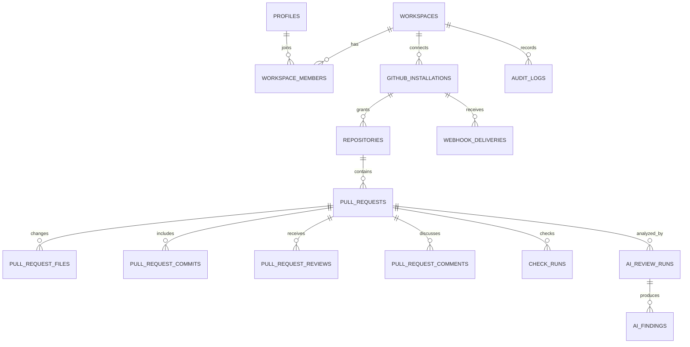

# Database Schema — PRAXD

## 1. Database principles

- PostgreSQL hosted by Supabase.
- Every user-facing record belongs to a workspace or is directly owned by an authenticated user.
- Use UUID primary keys for PRAXD entities and store GitHub's numeric/string IDs separately.
- GitHub remains the source of truth. Database rows are a synchronized read model.
- Use `timestamptz` for timestamps and `jsonb` only for external metadata that is not queried as a primary relational field.
- Enable Row Level Security (RLS) on every table exposed through Supabase's API.
- The service-role key is server-only. Never use it in a client component.

## 2. Entity relationship diagram

## 3. Tables

| Table | Purpose | Important uniqueness/index |
|---|---|---|
| `profiles` | User display metadata | `id = auth.users.id` |
| `workspaces` | Tenant boundary | owner, slug |
| `workspace_members` | User membership/role | `(workspace_id, user_id)` |
| `github_installations` | GitHub App installation metadata | unique `installation_id` |
| `repositories` | Synced repository list | unique `(installation_id, github_repo_id)` |
| `pull_requests` | PR read model | unique `(repository_id, number)`; index state/updated_at |
| `pull_request_files` | Changed files and optional patch cache | unique `(pull_request_id, github_file_id or file_path)` |
| `pull_request_commits` | PR commits | unique `(pull_request_id, sha)` |
| `pull_request_reviews` | GitHub review records | unique `github_review_id` |
| `pull_request_comments` | Issue and review comments | unique `github_comment_id` |
| `check_runs` | Check runs/status contexts | unique `(repository_id, github_check_id)` when available |
| `ai_review_runs` | AI review job and model metadata | indexed `(pull_request_id, created_at)` |
| `ai_findings` | Validated review findings | unique `(review_run_id, fingerprint)` |
| `webhook_deliveries` | Delivery deduplication and processing state | unique `delivery_id` |
| `audit_logs` | Security-relevant actions | workspace/time index |

## 4. Ownership and RLS

- `profiles`: user can read/update only their own profile.
- `workspaces`: members can read; owners/admins can update; owner can create/delete according to product rules.
- `workspace_members`: members can read workspace membership; only owners/admins can invite/change roles/remove members.
- All GitHub, PR, comment, check, AI and webhook rows are scoped to a workspace. Access requires membership in the row's `workspace_id`.
- Webhook and worker writes occur through trusted server-side service credentials after validating the installation-to-workspace mapping. Service-role access bypasses RLS, so server functions must still enforce explicit authorization and must never accept workspace IDs from the client without verification.
- Do not expose service-role credentials in generated client types or browser bundles.

The initial migration includes RLS enablement and membership-based read policies for user-facing data. Write policies may be tightened as server-side operations are implemented; do not solve authorization by disabling RLS.

## 5. Sync semantics

- Upsert by GitHub's stable identifiers.
- Keep `github_updated_at` separate from `synced_at`.
- Use nullable fields for data unavailable from GitHub rather than invented defaults.
- Track stale/deleted/suspended data; do not delete a PR solely because it is missing from one paginated response.
- For comments, distinguish `comment_type = 'issue'` from `comment_type = 'review'`.
- Cache patch text only when available, with a retention policy. Do not assume every changed file has a patch.
- Keep AI results tied to `head_sha` and mark older results stale after a head change.

## 6. Migration

The starter SQL is in `../migrations/0001_initial_schema.sql`. Review it in a Supabase development project before applying to production. Generate and commit TypeScript database types after the schema is applied.
